# Mushaf Analyzer

This project is sponsored by [@tarteelAI](https://github.com/TarteelAI) [](https://www.tarteel.ai/)

**Measuring a handwritten Qur'an, letter by letter, so a digital one can be
written the same way.**

The Old Madinah Mushaf was written by hand. Its calligrapher made a decision
for every letter on every line: how far to extend a joining stroke as a
**kashida**, how wide to draw a kaf, where to put a fatha, how much to compress
a word so the line comes out flush. Those decisions form the typographic
knowledge a digital Mushaf font must reproduce, and the letterforms preserved
in the handwritten Mushaf are the primary evidence from which those rules can
be recovered.

This tool makes that calligraphic knowledge searchable and measurable. Instead
of relying on a few manually selected examples, a font designer can compare
every occurrence of a letter form, identify recurring forms and ligatures, and
measure how letterforms are compressed and how far joining strokes are
extended as kashidas. That evidence can be used to infer the calligraphic and
justification rules of the Mushaf, then apply them in digital glyph design,
spacing, and layout systems. The same pipeline can ultimately be adapted to
study other Masahif in the same way.

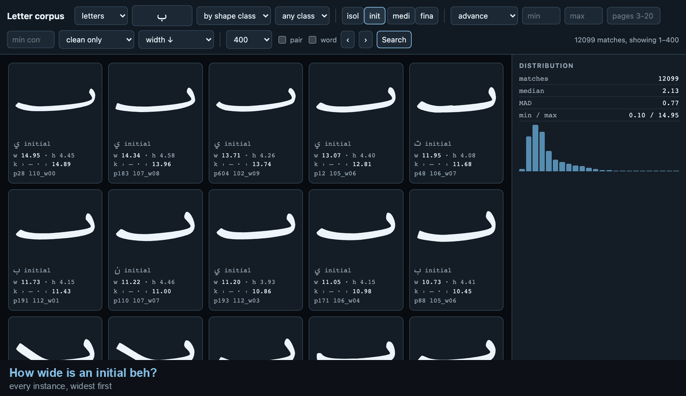

It takes page scans plus the Qur'an text, segments each page into words, then
into PAWs (Arabic letter-groups), then into individual letters and diacritical
marks, and finally builds one SQLite index holding **324,320 letters and
434,199 marks over the whole Mushaf** — 602 pages, each letter with its
outline, its mask, and its measurements normalized to that page's qalam width.

---

## Contents

- [What you can ask it](#what-you-can-ask-it)
- [The pipeline](#the-pipeline)
- [Getting started](#getting-started)
- [Stage 1 — page → words, PAWs, marks](#stage-1--page--words-paws-marks)
- [Stage 2 — PAW → letters](#stage-2--paw--letters)
  - [What a measurement means](#what-a-measurement-means)
- [Stage 3 — build the corpus index](#stage-3--build-the-corpus-index)
- [Stage 4 — browse and measure](#stage-4--browse-and-measure)
- [Outline tracing, and how to debug it](#outline-tracing-and-how-to-debug-it)
- [Querying the index directly](#querying-the-index-directly)
- [What is in the index](#what-is-in-the-index)
- [Mark templates and the optional classifier](#mark-templates-and-the-optional-classifier)
- [Analyzing a different Mushaf](#analyzing-a-different-mushaf)
- [Repository layout](#repository-layout)
- [Contributing](#contributing)
- [Related](#related)
- [Current limitations and next steps](#current-limitations-and-next-steps)

---

## What you can ask it

The corpus browser is the practical outcome of the pipeline: it makes questions
such as these answerable from evidence across the whole Mushaf.

### "How wide is an initial beh-shaped letter?"

The browser compares all 22,201 clean initial letters in the senna
(beh-shaped) class. Each is rendered from its own traced outline and sorted
here by the outgoing kashida, shown in orange.

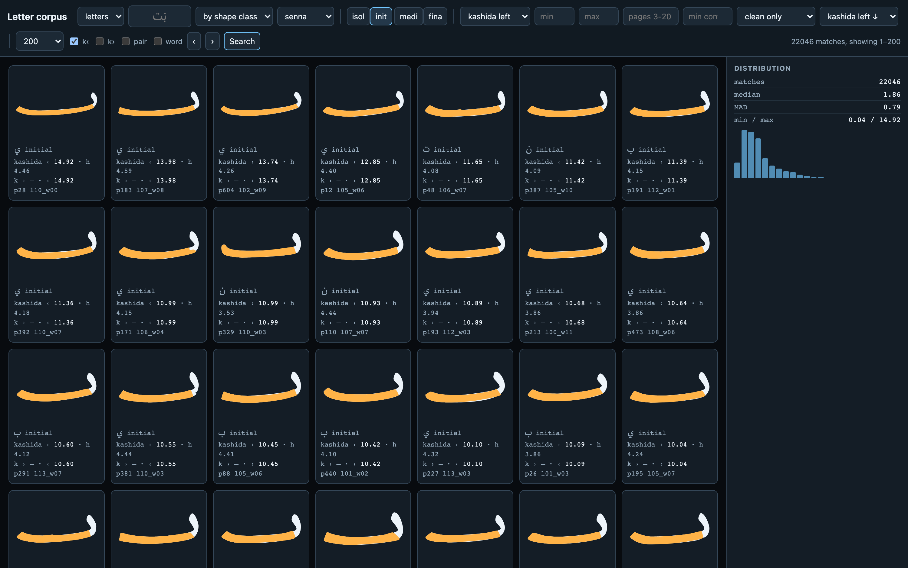

The advance runs from 0.16 to 14.97 qalam widths around a median of 2.16. The
visual distribution shows that the tooth changes little; most of the variation
comes from the kashida. On instances stretched past 6 qalam widths, the
kashida is **96.5% of the advance** on average, and even on compressed
instances at 3 widths or less it is 79%. The result is a nearly stable letter
body combined with an extensible joining stroke whose length responds to line
justification.

That is why the kashida is measured separately: 22,046 of these have an
outgoing kashida, median 1.86, out to 14.92. A font that assigns a single fixed
advance to the initial beh shape cannot reproduce this Mushaf; the joining
stroke must be extensible.

Sorting by kashida also keeps the list to single letters. A beh that
opens a ligature — the ب of `بِي` — does not own the joining stroke leaving the
group, so it is absent here by construction. Sorted by advance instead, those
ligatures lead the list with the whole ligature's width, which is a valid group
measurement but not a per-letter advance, and they shift the median from 2.16
to 2.30.

### "How much can the same letterform vary?"

Each row runs from the minimum to the maximum advance width, with three
specimens chosen as close as possible to evenly spaced widths between them.
All forms are drawn at the same qalam scale, so their sizes can be compared
directly. These measurements can guide the design of parametric glyphs by
showing how each letterform changes across its width range.

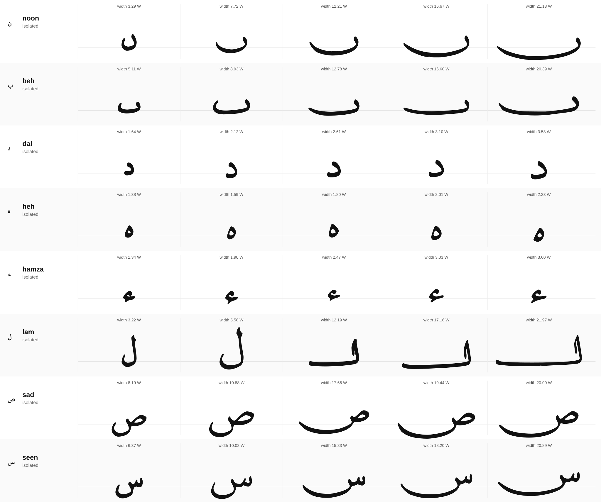

### "What is the longest kashida in the whole Mushaf?"

Set the metric to **kashida left** — or **kashida right**, since the two sides
are separately searchable — put 12 in `min`, tick `k‹` and **word**, and the
answer comes back with each kashida painted inside the word it holds
together. The orange is traced from the pixels the segmenter attributed to the
join, not a rectangle laid over the glyph. Click a card and the side panel
gives that instance in full — every width, the incoming and outgoing kashidas,
the letters on either side of the join, and the word as it sits on the page.

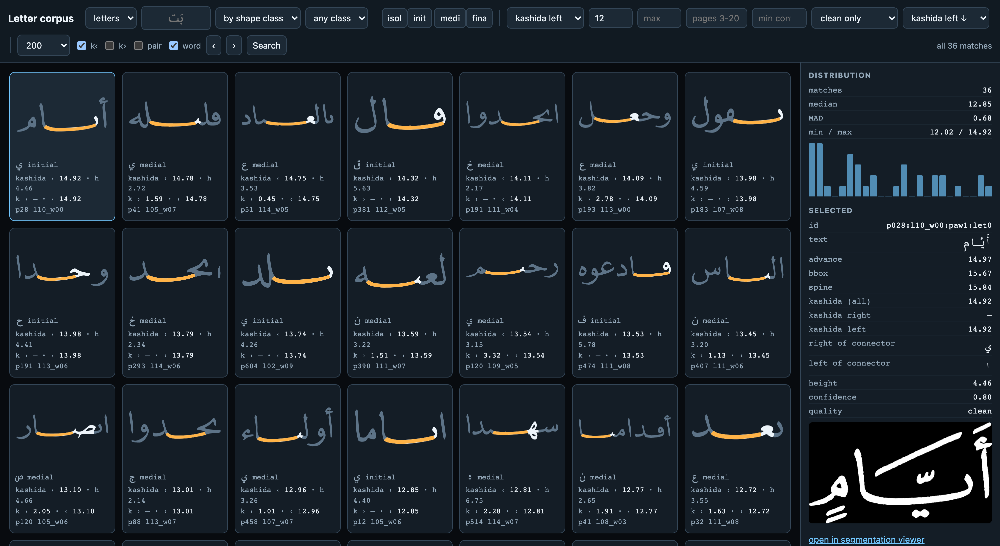

The record is **14.92 qalam widths** — an initial yeh joining to alef in
`أَيَّامٍ`, page 28, line 10. On that page's scan that is 1,407 pixels of
kashida at a stroke width of 94. Against a median kashida of 1.90 across all
140,307 clean traced kashidas, the longest kashida in the book is **eight
times** the ordinary one, and it is nearly the whole of the letter's 14.97
advance.

They are rare and they are spread out — 36 instances at 12 qalam widths or
more, on 26 different pages, 6 of them past 14:

| kashida | instances | of all kashidas |
| ---: | ---: | ---: |
| ≥ 6 W | 4,037 | 2.88% |
| ≥ 8 W | 978 | 0.70% |
| ≥ 10 W | 184 | 0.13% |
| ≥ 12 W | 36 | 0.03% |
| ≥ 14 W | 6 | 0.00% |

Two thirds sit in medial position, and the pairs repeat: `ن→ا` five times,
`ي→ا`, `ي→ل` and `ق→ا` three each. A justification model needs both
parts of this evidence: which joins were extended and how far they were
extended when the line required additional width.

### "Which letters are never written on their own?"

Some pairs form a single shape. In this calligraphic style, `فِي` is written as
one continuous form with no observable internal boundary. The segmenter
therefore preserves it as **one uncut body spanning two letters**, and the
browser displays the complete ligature under either letter, measured as a
group and labelled `lig`.

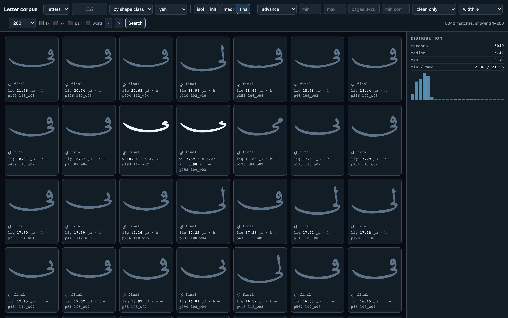

Search final yeh and both populations come back in one list: the ones written
separately carry their own `w`, the ligatures carry `lig في` with the ligature's
advance. 19,700 letters sit in 9,850 uncut groups; the largest families are
`fa-yeh` (2,466), lam-alef over four templates (4,298), `beh-hah-core` (1,807),
`beh-heh-init` (740) and `kaf-alef-zigzag` (539).

### "Show a letter sequence in its word context"

Enter a letter sequence (`بت`, `من`) to match it within a single PAW.
Select **word** to display the complete word, with the match highlighted and
the remaining letters dimmed, so every measurement retains its original
context.

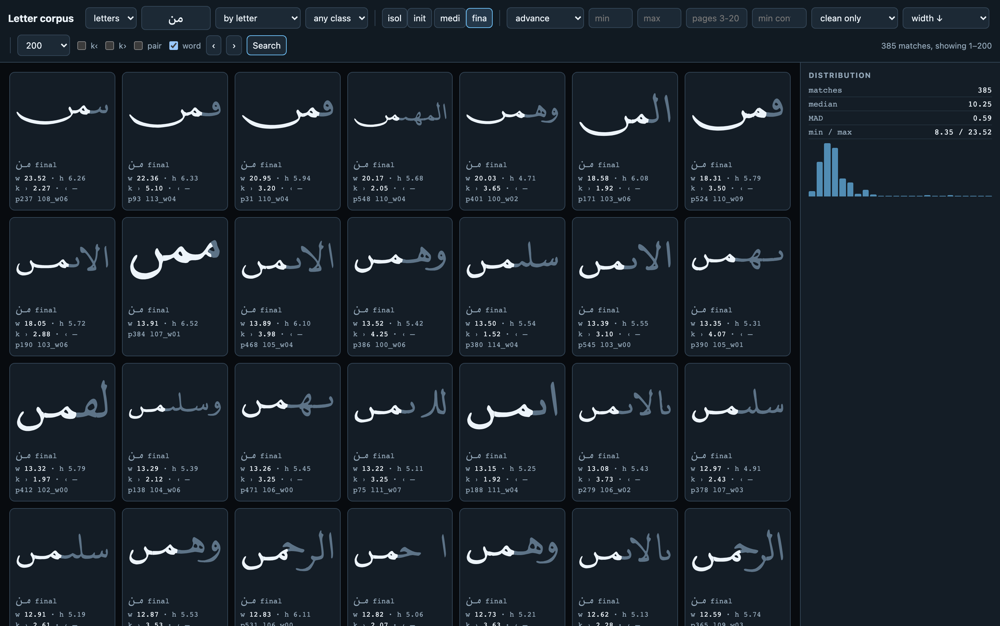

### "How long is a fatha?"

Marks are indexed alongside letters and answer the same way. 122,338 fathas,
largest first, with the distribution.

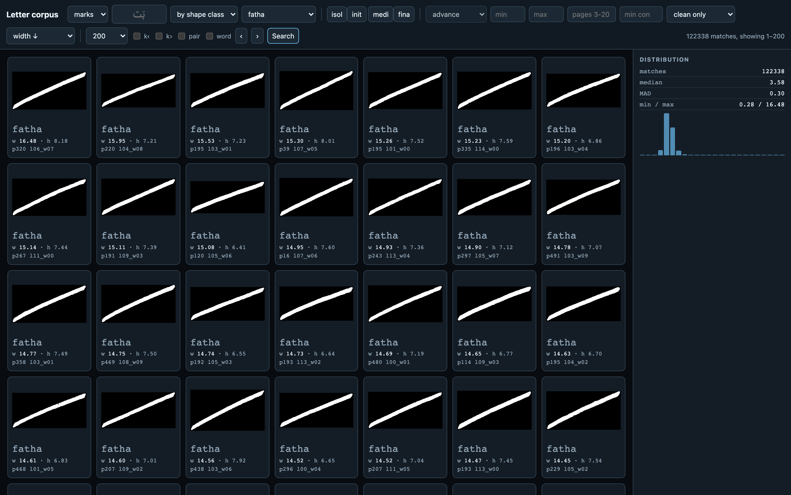

### "Which instances were stretched to justify a line?"

Every measurement is filterable. `advance ≥ 6` over initial beh leaves the ones
the calligrapher pulled out, and their kashida lengths are right there on the
cards. Sorting by `kashida left` instead ranks the same population by how much
of that width is kashida rather than letter body.

### "Is that counter real, or did the scanner drop it?"

A 4800-DPI scan of 1970s offset printing puts holes in the ink that the
calligrapher never made, and a spurious hole changes the medial axis, which
changes the segmentation. Shape alone cannot separate a dropout from a small
counter — but the greyscale can: a real counter is paper, a dropout is ink that
thresholded the wrong way. `mushaf_cli` fills any hole whose 90th-percentile
grey is darker than 0.72 of the way from ink level to paper level.

On page 109 that is 1,554 holes closed for 0.051% more ink; the worst word in
the Mushaf went from 59 holes to 1, its medial-axis loops from 11 to 1, and its
skeleton events from 72 to 29. `--no-hole-repair` turns it off and reproduces
the old masks byte for byte.

---

## The pipeline

Four stages. Two languages, split where the work changes character: the
expensive, settled image work is C++; the experimental segmentation and every
viewer is Python.

```
   page scan (JPEG)  ─┐
                      ├──▶  [1] mushaf_cli (C++)      ──▶  words.json + mask PNGs
   quran-data.sqlite ─┘          page → lines → words → PAWs → body / marks

                            [2] segment_paw_letters.py ──▶  per-pixel letter labels
                                 PAW body → medial axis → spine → events → letters

                            [3] build_corpus.py        ──▶  corpus.sqlite
                                 + outline tracing, normalization

                            [4] serve_corpus.py         ──▶  the letter browser
                                review_segmentation.py  ──▶  the word/PAW/mark viewer
                                review_paw_segmentation.py  ─▶  letter-segmentation diagnostics
```

Here is one word, `عَلَيْهِمْ`, through the first three of them:

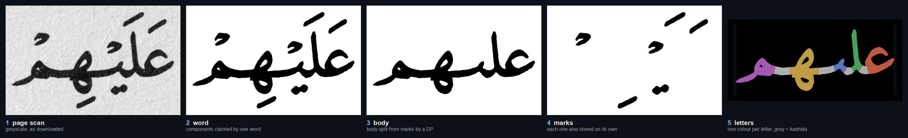

Two properties are fundamental. **The text constrains the segmentation**: the
analyzer knows that `عَلَيْهِمْ` contains five letters and six marks before
examining the page image, and aligns that known sequence with the observed
shapes instead of performing unconstrained recognition. **Coverage remains
explicit**: a PAW that cannot be cut still contributes its expected letter
rows, marked as failed, so queries cannot silently under-report the text.

---

## Getting started

### You will need

- **CMake ≥ 3.24**, a **C++20** compiler, **OpenCV**, and **SQLite3** (Glaze is
  fetched automatically)
- **[uv](https://docs.astral.sh/uv/)** for Python 3.11+ and the Python
  dependencies:

  ```bash
  uv sync --locked
  ```

- **`input/quran-data.sqlite`** — the Qur'an text and page layout. This file is
  not distributed with the repository; it can be prepared from the Quranic
  text and Mushaf layout data published by
  [QUL (Quranic Universal Library)](https://qul.tarteel.ai/) thanks to
  [@tarteelAI](https://github.com/TarteelAI) for making these resources
  available to developers and researchers.
- **Page scans** — see the note below

### Build the C++ analyzer

```bash
uv run cmake -S . -B build -DCMAKE_BUILD_TYPE=Release
uv run cmake --build build
```

That produces `build/mushaf_cli`.

### About the scans

> [!IMPORTANT]
> The high-resolution scan set this project was measured on
> (`input/oldmedina2`, roughly 18500 × 27500 px per page, giving a qalam
> stroke about 94 px wide) is **not redistributed here**. The measurements
> depend on that resolution: the medial-axis work needs a stroke tens of
> pixels across, and the web-resolution scans that `tools/download_old_madinah.py`
> fetches from [tafsir.app](https://tafsir.app/scans/m-madinah-old) (759 × 1100)
> are useful for reference but far too small to measure.

Point `--input` at any directory of numbered page images. Everything below
assumes `input/oldmedina2` and page 3 as the worked example.

---

## Stage 1 — page → words, PAWs, marks

`mushaf_cli` estimates the baselines, cuts the page into lines and words,
derives what each word *should* contain from the Qur'an text, and then runs a
second dynamic program inside each word that assigns every connected component
to a PAW and to either the body, a named mark class, or `other`.

```bash
build/mushaf_cli \
  --input input/oldmedina2 \
  --out output/oldmedina2-analysis \
  --pages 3 \
  --database input/quran-data.sqlite \
  --segmentation-exceptions templates/oldmadina/segmentation_exceptions.json \
  --mark-template-root templates/oldmadina/mark-templates \
  --recognizer-cache output/component-recognizer-cache \
  --recognizer-source old \
  --blurK 0 --morphK 0
```

Binarization also repairs under-inked holes, on by default: any enclosed hole
whose 90th-percentile grey is darker than `--hole-repair-paperness` (0.72) of
the way from the page's ink level to its paper level is scanner dropout rather
than a counter, and is filled. The percentile matters — the median understates
a small aperture darkened by ink bleed — and ink islands inside a hole are
preserved. `--no-hole-repair` reproduces the previous masks byte for byte.

`--pages` takes `3`, `3-20`, `3,7,9` or `all`; `--jobs N` runs pages in
parallel; pages that already have a complete `words.json` are skipped unless
you pass `--force`. Processing all 604 scans takes hours, so it resumes by
default; the corpus described below indexes the 602 text pages from 3 to 604.
One page takes about 18 seconds with review artifacts.

Per page you get `words.json` (schema 8 — the assignment, its cost, and every
path) plus PNG masks: one per word, one per PAW, one for each PAW's body, one
for its combined marks, and **one per semantic mark instance** — two fathas
over one PAW are two separate masks, while a multi-part mark like dammatan
keeps its components together.

### Inspect the output

```bash
uv run tools/review_segmentation.py \
  --root output/oldmedina2-analysis --port 8878
```

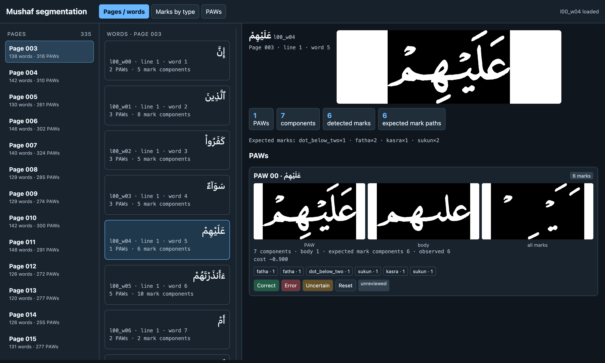

Navigate pages → words → PAWs, or switch to **Marks by type** to browse every
detected mask grouped by class, or **PAWs** to filter for the suspicious ones
(empty bodies, several bodies, `other` marks, count mismatches). Review
verdicts go to `output/oldmedina2-analysis/.segmentation-review.json`; the
generated masks and `words.json` are never modified.

---

## Stage 2 — PAW → letters

Letter segmentation is the most challenging stage, so it has a dedicated
diagnostic viewer.

A PAW body is a single connected stroke. Cutting it into letters is done by
building the **Voronoi medial axis** of the traced contour, extracting a
**spine** (a shortest path from the rightmost substantial point to the
leftmost), reading **events** off that spine — branches, peaks, valleys, x
crossings, terminal ascents — and then aligning the *known* sequence of letters
against those events using elastic templates in
[`skeleton_templates.json`](templates/oldmadina/skeleton_templates.json).

The measurement that actually discriminates a join is not stroke thinness — in
this hand the joining strokes are barely thinner than the letter strokes — but
the local **cut cost**: how much ink a line perpendicular to the spine has to
sever. At a join that is one run about a stroke wide; inside a letter the same
line also crosses an ascender, a bowl, or a returning tail.

The viewer exposes each processing stage as a separate layer:

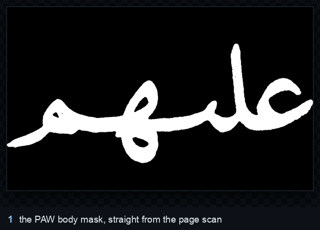

```bash
uv run tools/paw_segmentation/review_paw_segmentation.py \
  --analysis output/oldmedina2-analysis \
  --page 3 --word l00_w04 \
  --templates templates/oldmadina/skeleton_templates.json \
  --port 8879
```

Displaying only **Letter bodies** and **Kashida pixels** shows the per-letter
pixel attribution from which every measurement is derived:

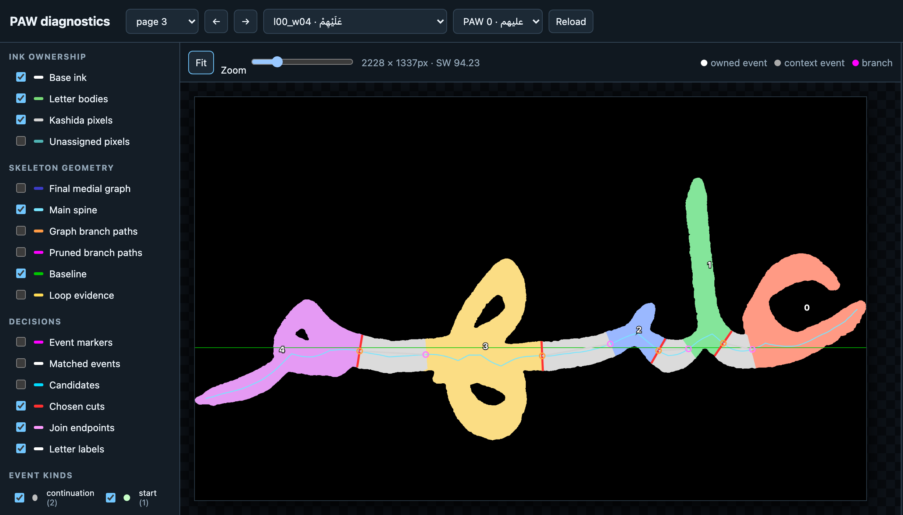

A right-hand pane, cropped out here, shows which template matched each letter,
which events it owned, and — when a PAW fails — the alignment trace saying
exactly which required event was missing, too weak, or already consumed by the
previous letter. Press `r` to reload after editing the template JSON; nothing
else in the process is cached, so template tuning is a live loop.

### What a measurement means

Per-letter pixel attribution is the source of every measurement in the corpus.
In the figure above, each letter body has its own colour — ع, ل, ي, ه, م,
labelled 0 to 4 from right to left. Grey denotes kashida pixels, red chords
denote the selected cuts, green marks the baseline, and cyan marks the spine.

"Width" gives three different answers, so all three are stored — and the
kashida is measured separately on each side, because the joining stroke leaving
a letter and the one arriving at it are different decisions by the hand.

Read the medial yeh, blue, labelled **2**. The grey to its **right**, between
it and the lam, is the joining stroke arriving at it: `kashida ›`, and it
belongs to the lam. The grey to its **left**, between it and the heh, is the
one it leaves: `kashida ‹`, and that one is its own. Its entry and exit are
the red chords on either side, and the corpus records it as:

| advance | bbox | spine extent | height | kashida ‹ | kashida › |
| ---: | ---: | ---: | ---: | ---: | ---: |
| 3.77 | 4.05 | 4.09 | 2.21 | 2.25 | 1.06 |

Three quarters of that 3.77 advance is its outgoing kashida. This separation
of letter body and kashida is central to modeling the calligraphic style.

- **advance** — baseline distance from the letter's entry point to its exit
  point, both read off the medial spine. The analogue of a font advance, and
  the default sort. It runs entry → exit, so it *includes* the kashida the
  letter leaves.
- **bbox** — ink bounding box, which includes descender overhang that belongs
  to the letter visually but not metrically.
- **spine extent** — the arclength the stroke actually travels, which exceeds
  the advance wherever the stroke rises and falls between the two points.
- **kashida ‹** — the joining stroke the letter *leaves*, the last stretch of
  its own span, in front of the exit point. This is the one stored on the row,
  as `kashida_norm`.
- **kashida ›** — the joining stroke *arriving* from the right. It is not this
  letter's: it is the previous letter's outgoing kashida, the same stroke read
  from the other end. No separate measurement is required; the browser reads
  it from the preceding letter row.

The two are separately searchable, so "which letters accept a long kashida
before them" and "which stretch the one after them" are different questions
with different answers. A final letter has only a `›`, an initial one only a
`‹`, and the browser prints `—` rather than `0.00` for the side that does not
exist — a PAW boundary has no stroke to measure, which is not the same as a
stroke measuring zero.

A group of letters written as one uncut shape shares one outgoing kashida. It
is assigned to the letter at the end of the group, so a run's total counts each
joining stroke once.

A letter inside an uncut ligature has no independently measurable advance
because the shape has no observable internal boundary. Its advance column is
therefore NULL. The *group's* advance is measurable and is reported for every
member with the label `lig`, distinguishing it from a per-letter measurement.

Every one of these is stored twice: in pixels (`*_px`) and divided by that
page's nominal qalam stroke width (`*_norm`). Scan scale varies — pages here
range from 79.9 px to 102.5 px per stroke — so **only the `_norm` columns are
comparable across the Mushaf**, and those are what the browser sorts on.

The same scale defines the letter frame used by the stored outlines: origin at
the entry point on the baseline, y up, x along the writing direction, in qalam
widths. That is what lets fifty instances from fifty pages be laid on one
baseline, and what makes the `word` view able to place a whole word from
advances alone without manual visual registration.

To run the segmenter without the viewer:

```bash
# one word
uv run tools/paw_segmentation/segment_paw_letters.py \
  --analysis output/oldmedina2-analysis --page 3 --word l00_w04 \
  --body-join-alignment --out output/paw-segmentation

# a whole page
uv run tools/paw_segmentation/segment_paw_letters.py \
  --analysis output/oldmedina2-analysis --page 3 --batch \
  --body-join-alignment --out output/paw-segmentation-page3
```

> `skeleton_templates.json` is a central research output of this project. Each
> template says what a letter's shape must look like along the spine, with
> tolerances; each constant in `segment_paw_letters.py` carries a comment
> recording the measurement that set it. Changes are validated by A/B runs
> over thousands of PAWs rather than by subjective inspection alone.

---

## Stage 3 — build the corpus index

```bash
uv run tools/corpus/build_corpus.py \
  --analysis output/oldmedina2-analysis \
  --out output/corpus/corpus.sqlite \
  --pages all --jobs 8 --resume
```

The builder calls the segmenter **in process** rather than reading its JSON,
because the per-pixel letter attribution is a NumPy array that never reaches
the JSON. That attribution produces the per-letter mask from which its outline
is traced. Each letter row stores its mask (zlib run lengths, in the database
rather than as hundreds of thousands of tiny PNGs) and its outline, traced
through the same no-potrace pipeline that the font
builder uses — see [Outline tracing, and how to debug
it](#outline-tracing-and-how-to-debug-it) for its method and diagnostic tools.

Budget roughly **35 s per page per core**, and about 2.2 MB per page: a
474-page rebuild took 26 minutes wall with `--jobs 12`. The full index here is
1.3 GB. When you ask for fewer pages than `--jobs`, the builder
splits each page's words across the spare workers instead of leaving them idle,
so a single page takes about 5 s rather than 45. This supports rapid iteration
after a segmenter change. The build is idempotent per page, so
`--pages 300-350` can be re-run after a segmenter change and replaces exactly
those pages; `--resume` skips pages already indexed. `--no-trace` skips outline
tracing when only the metrics are required.

---

## Stage 4 — browse and measure

```bash
uv run tools/corpus/serve_corpus.py \
  --db output/corpus/corpus.sqlite \
  --analysis output/oldmedina2-analysis \
  --port 8880 --viewer-port 8879
```

Open <http://127.0.0.1:8880/>.

| control | what it does |
| --- | --- |
| **kind** | letters or marks. A kashida is stored as a side-specific measurement of a letter rather than as a separate entity, so it appears as a metric and a pair of display toggles |
| **letters box** | one or more letters, matched as a run inside one PAW: `بت` finds a beh followed by a teh. Type a diacritic after a letter to require it — `بَ` is a beh carrying a fatha |
| **by shape class / by letter** | whether `ب` means "anything written with the senna tooth" or literally beh |
| **isol / init / medi / fina** | where the run sits in its PAW |
| **metric** | which width the filters, the sort and the histogram all mean: advance, bbox, spine, height, kashida (all / left / right) — see [What a measurement means](#what-a-measurement-means) |
| **min / max** | filter on that metric, in qalam widths |
| **quality** | `clean only` by default; flagged and failed instances are there but must be asked for |
| **k‹ / k›** | paint the outgoing or incoming kashida. Picking a kashida metric ticks the matching box once, so the measured joining stroke is shown in context |
| **pair** | also draw the letter joined by the kashida |
| **word** | draw the whole word around the match |

With `--viewer-port` set, every card links back to that exact word in the
Stage 2 diagnostics viewer, so "why is this one measured like that?" is one
click away.

---

## Outline tracing, and how to debug it

Every letter outline in the index — and every glyph the font builders emit —
comes out of one pipeline in `tools/tracing/`, entered through
`contour_to_beziers`. It turns a staircase of boundary pixels into cubic
Béziers that preserve significant contour features while suppressing raster
roughness. A loose fit flattens bowls; an overly tight fit converts scanning
artefacts into unnecessary nodes.

### How it works

**1. Contours, with their nesting.** `find_contours_with_hierarchy` returns the
outer boundary and every hole, and `skip_tiny_hole_subtrees` drops holes under
`MIN_HOLE_AREA_PX` (500 px²) together with anything inside them — sub-pixel
threshold noise, not counters. Orientation is normalized, outer
counter-clockwise and holes clockwise, so `fill-rule: nonzero` cuts a counter
out instead of filling it.

**2. Split at the extrema.** `detect_browse_extrema_closed_typed` finds the
points where the contour has a horizontal or a vertical tangent — typed
`xmin`, `xmax`, `ymin`, `ymax` — and the contour is cut into arcs between
consecutive extrema, each fitted on its own. Two reasons: the arcs come out
monotone in both axes, which a single cubic can represent accurately, and the
nodes land at extrema, where TrueType hinting and interpolation expect them.

**3. The prominence gate — this is what keeps pits, hollows and bumps out.**
`_is_browse_extremum_1d` does not test a local derivative, which on a
rasterized boundary would fire on every stair-step. From a candidate point it
walks the contour *both ways* and requires the coordinate to fall away by more
than `min_arc_height` on each side before it ever comes back level. A bump or a
hollow shallower than that never becomes an extremum, so it never forces a
node, and the fitter is free to run a smooth curve straight past it. In
production `min_arc_height` is **6 px** against a ~94 px qalam stroke — about
6% of the stroke width. `find_midpoint` then places the extremum at the middle
of a flat plateau rather than at whichever sample happened to come first, so a
flat top does not acquire an off-centre node.

**4. Inflections inside an arc.** An arc between two extrema is monotone but
can still change its sense of curvature, and one cubic through such an arc
either bulges or flattens. They are found through straight segments rather
than through a curvature estimate, which on pixel data is noise: the arc is
reduced by Douglas–Peucker at `straight_seg_tol` (9 px), `merge_small_bumps`
absorbs neighbours differing by under 1° or shorter than 5 px, and a segment
counts as an inflection when the segments before and after it turn to
*opposite* sides of it by at least 5°. Two optional gates reject weak
candidates: `infl_min_mid_len` (the straight bit is too short to trust) and
`infl_max_mid_dev` (it is not actually straight).

**5. Controlled splitting.** Each piece is fitted with a Schneider-style
least-squares cubic with its endpoint tangents pinned by the extremum types —
vertical at `xmin`/`xmax`, horizontal at `ymin`/`ymax` — refined by
`reparam_iters` Newton reparameterization passes. If the worst error is still
over `tol`, the span is split; but *not* at the worst-error point, which is one
noisy pixel and tends to produce two children barely better than their parent.
`_pick_best_split` tries several candidates, refits both children for each, and
keeps whichever minimizes the **worse** of the two child errors, discarding
candidates whose children would contain an unsupported inflection. `max_splits`
caps the recursion; a leaf still over tolerance is kept rather than split
further, because an unsupported split is worse than a controlled residual
error.

Production values live in one place,
[`tools/corpus/geometry.py`](tools/corpus/geometry.py) — `tol=8.0`,
`min_arc_height=6.0`, `reparam_iters=5`, `straight_seg_tol=9.0` — and match the
SVG builder's CLI defaults, so a letter traced independently for the corpus
matches the same letter traced within its word mask.

### The viewer

```bash
uv sync --locked --group viewer
uv run tools/tracing/vector_fit_viewer.py
```

Run it from the repository root (it needs `PySide6` and `matplotlib`). The left
tree lists every word image under `output/oldmedina2-analysis`; **Open image**
takes anything else. The toolbar starts in zoom-to-rectangle, and changing a
parameter keeps the current zoom, so you can sit on one join and sweep a knob.

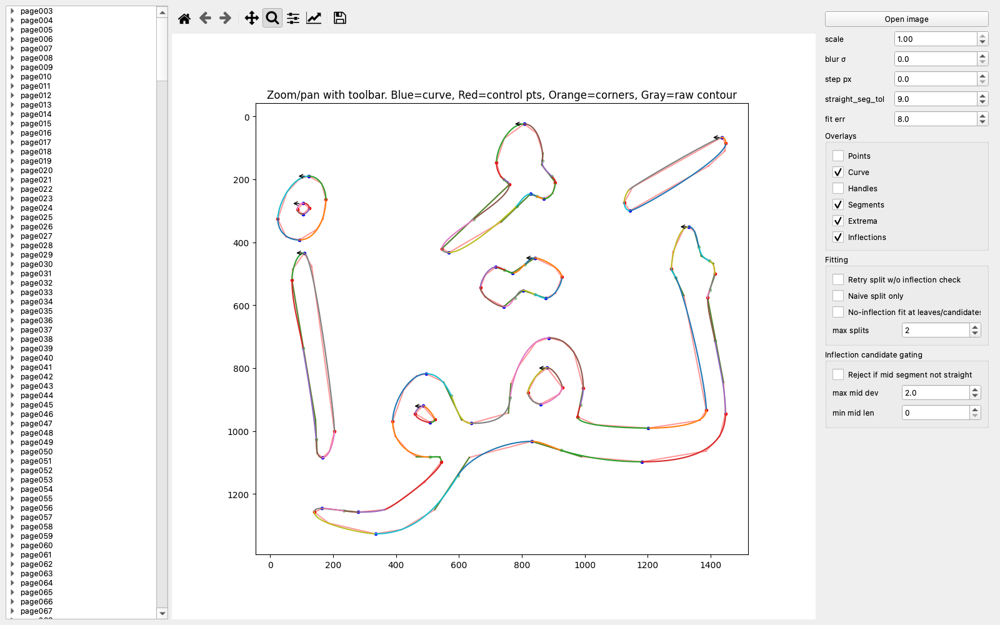

The overlays are drawn from `bez.segs / bez.infls / bez.extrema` — the very
values the fitter used to produce those cubics, not a recomputation — so what
you see cannot disagree with what was fitted.

| overlay | shows |
| --- | --- |
| **Points** | the resampled contour samples |
| **Curve** | the fitted cubics |
| **Handles** | control points and their tangent arms |
| **Segments** | the Douglas–Peucker straights that inflection detection reads |
| **Extrema** | red for a vertical tangent (`xmin`/`xmax`), blue for a horizontal one (`ymin`/`ymax`) — this is the arc partition |
| **Inflections** | green, on the straight segment that separates two opposite turns |

| control | what it changes |
| --- | --- |
| **fit err** | `tol`, the error that triggers a split |
| **straight_seg_tol** | the RDP tolerance, so how coarse the straight decomposition — and therefore inflection detection — is |
| **max splits** | the recursion cap |
| **scale / blur σ / step px** | simulate a lower-resolution or blurrier scan without re-rasterizing, to see how the fit degrades |
| **Naive split only** | revert to splitting at the worst-error point to evaluate the benefit of `_pick_best_split` |
| **Retry split w/o inflection check** | second pass judging candidates on error alone, when every candidate was disqualified |
| **No-inflection fit at leaves/candidates** | opt-in, and known to misbehave on a couple of contours — see the note in `FitConfig` |
| **Reject if mid segment not straight / max mid dev / min mid len** | the inflection-candidate gates |

**A gap worth knowing about:** `min_arc_height` — the prominence gate, the one
threshold that decides whether a bump becomes a node — is *not* exposed as a
control. The viewer hard-codes 6 in `_render`, so you can see which extrema
survived but cannot sweep the threshold that chose them without editing that
line.

For quantitative evaluation of a tracing change,
`tools/tracing/tracing_eval_harness.py` runs a fixed manifest of representative
contours through the production call chain and writes per-case overlays plus a
`report.json` and `index.html` with topology, timings, inflection counts and
per-curve fit error:

```bash
uv run tools/tracing/tracing_eval_harness.py --out output/eval_harness
```

Check its `DEFAULT_MANIFEST` first: the cases are named by contour index into
a word image, and those indices move when the analysis output is rebuilt.

For effective diagnosis, turn **Extrema** on first and inspect the arc
partition before the fitted curve: a node in the middle of a smooth bowl means
a bump cleared `min_arc_height`, while a corner without a node did not. When a
fit is incorrect, inspect **Segments** next; most failures originate in the
upstream inflection decision rather than in the least-squares solve.

---

## Querying the index directly

The browser provides interactive access, while the SQLite index supports
direct aggregate analysis. Every column below is defined in
[What a measurement means](#what-a-measurement-means), which also explains why
only the `_norm` ones are comparable across pages.

```sql
SELECT char_class, form, COUNT(*) AS n,
       ROUND(AVG(adv_w_norm), 2)   AS mean_advance,
       ROUND(MIN(adv_w_norm), 2)   AS min,
       ROUND(MAX(adv_w_norm), 2)   AS max,
       ROUND(AVG(kashida_norm), 2) AS mean_kashida
FROM letters
WHERE ok = 1 AND low_confidence = 0 AND ink_px > 0
  AND adv_w_norm IS NOT NULL
GROUP BY char_class, form
HAVING n > 500
ORDER BY mean_advance DESC
LIMIT 12;
```

```
char_class  form       n     mean_advance  min   max    mean_kashida
----------  --------  -----  ------------  ----  -----  ------------
kaf         initial    3073  10.47         2.01  24.26  2.82
sad         isolated    526   9.87         7.66  24.75  0.0
sad         medial     1749   9.5          5.24  20.57  2.72
sad         initial    1043   9.06         5.01  17.86  2.57
kaf         medial     4086   9.0          0.2   27.13  0.46
kaf         final      1845   8.92         5.47  21.81  0.0
seen        medial     3750   8.29         2.25  19.06  2.54
beh         final      2212   8.24         0.9   18.81  0.0
beh         isolated   1531   8.06         3.82  24.11  0.0
seen        initial    3173   7.31         3.41  16.08  2.83
tah         medial     1296   7.03         1.33  14.78  2.93
noon        isolated   6338   6.78         1.0   21.17  0.0
```

Note the zero mean kashida on every final and isolated form — those letters do
not join to the left, so there is no outgoing kashida to measure. Such
consistency checks should precede interpretation of the results.

### Tables

| table | one row per | notable columns |
| --- | --- | --- |
| `pages` | page | `nominal_stroke_px` (the normalizer), `letters_expected` vs `letter_count` |
| `words` | word | `word_key`, `text`, `expected_paws` vs `observed_paws` |
| `paws` | PAW | `ok`, `reason`, `confidence`, `alignment_mode`, `spine_length` |
| `letters` | letter | every width in px and norm, `char_class`, `form`, `template`, `confidence` |
| `letter_shape` | letter | `path_d` outline, view box, `mask_rle`, entry/exit points |
| `marks` | semantic mark instance | `class`, `component_indices`, `owning_letter_id`, `area_norm` |
| `runs` | build | `argv` and `git_commit`, so a row can be traced to the code that made it |

Instance ids are deterministic and readable — `p003:l00_w04:paw0:let2` — so an
id that named a letter before a rebuild names the same letter after it.

---

## What is in the index

The index is not redistributed (`output/` is git-ignored). These are the
figures from the build described above, over the whole Mushaf:

| | |
| --- | ---: |
| pages indexed | 602 (of 3–604) |
| words | 77,391 |
| words assigned the expected PAWs | 77,168 (99.7%) |
| words passing automatic letter segmentation | 73,202 (94.6%) |
| PAWs | 160,539 |
| PAWs passing automatic letter segmentation | 154,979 (96.5%) |
| letters expected from the text | 324,320 |
| letter rows indexed | 324,320 (100%) |
| clean letters | 311,446 (96.0%) |
| letters in an uncut ligature | 19,700 (9,850 groups) |
| letters with a traced outline | 304,420 |
| letters with a traced kashida | 140,420 |
| mark instances | 434,199 in 31 classes |
| qalam stroke width across pages | 79.9 – 102.5 px |
| index size | 1.3 GB |

Here, a word passes automatic letter segmentation when the analyzer does not
abstain, its expected and observed PAW counts match, and every PAW finds an
acceptable cut sequence. Passing these checks does not prove that every cut is
at the correct letter boundary: a small number of accepted PAWs may still
contain miscuts that can only be identified by manual inspection.

Letter coverage is 100% **by construction**: the letters of a word are known
from the text before the page image is examined, so a PAW the segmenter cannot
align still contributes its full set of rows — recorded as failed rather than
dropped.
`pages.letters_expected` sits next to `letter_count` precisely so that a
shortfall — the one failure mode that would make a query silently
under-report — is visible.

A letter row can have three independent quality states:

| state | rows | means |
| --- | ---: | --- |
| `low_confidence = 1` | 295 | cut, but the weakest cut in the PAW was thin |
| `ok = 0` | 12,579 | the PAW could not be aligned; `paws.reason` says why |
| `ink_px = 0` with `group_size > 1` | 7,321 | segmented correctly, but written inside a ligature, so the group mask is assigned to the letter into which the form is fused |

Only the middle row is a failure. The last one used to be counted as one, which
hid 6,095 correctly-segmented letters — more than half of all final yehs — in
the `failed` bucket.

---

## Mark templates and the optional classifier

Stage 1 identifies marks from two sources of evidence: the marks required by
the Qur'an text and the observed component shapes. Shape evidence comes from a
**template bank** of reviewed component masks, one directory per class, passed
on the command line:

```
--mark-template-root templates/oldmadina/mark-templates
```

The checked-in bank used by the documented pipeline is described in
[`templates/oldmadina/README.md`](templates/oldmadina/README.md), including
the cases that are not one mask per class, such as `waqf_qaf` and
`waqf_jeem` storing only the body while the recognizer finds the detached
companion by geometry, and `kasratan/open/` holding the variant whose lower bar
shifts left.

Template scores are soft, class-specific evidence, never a decision: a fatha
bank acts as a *negative* competitor for hamza-above, maddah and small alef are
separated by competition rather than by geometry because their scan forms
overlap, and the word-level dynamic program can still abstain when the evidence
is weak.

To extend the bank, export candidate masks with `--export-component-dataset`,
build a manifest with `tools/prepare_mark_annotations.py`, review it in
`tools/review_mark_annotations.py`, and rebuild with
`tools/build_mark_template_bank.py`. `tools/auto_assign_mark_labels.py` can
propose labels for lines whose component counts already match the text exactly,
which is a starting queue, not a label source — its "uniqueness" is a geometric
margin, not a calibrated probability.

**An optional ONNX mark classifier is also supported, but the documented
pipeline does not enable it.** `tools/train_mark_classifier.py` trains one and
`mushaf_cli` will consume it with `--mark-model`, `--mark-inventory-penalty`
and `--small-yeh-class-weight`,
scoring class probabilities against the text's expected mark inventory before
the word-boundary DP. It exists because a final small yeh that straddles a word
boundary is hard to place on geometry alone. No trained model or annotation
manifest is checked in here, the Stage 1 command above does not pass one, and
every figure and number in this file was produced without it. Treat it as a
feature that is implemented but not yet validated: if enabled, tune it only
against page-disjoint reviewed pages, because a weight large enough to repair
a small-yeh boundary is also large enough to amplify a false positive.

---

## Analyzing a different Mushaf

Everything specific to one Mushaf lives in `templates/<name>/`, and a second
one gets a sibling directory rather than edits to the first:

```
templates/oldmadina/
  skeleton_templates.json       --skeleton-templates    letter shapes for this hand
  mark-templates/               --mark-template-root    reviewed masks, one dir per class
  segmentation_exceptions.json  --segmentation-exceptions   per-page overrides
```

Nothing else in the repository is Mushaf-specific. The C++ analyzer, the
segmenter, the corpus builder and all three viewers take these as arguments.

### What you must supply

- **Page scans**, numbered, in one directory. Resolution is the hard
  requirement: the medial-axis work needs a qalam stroke tens of pixels
  across, and the segmenter's constants are all multiples of the measured
  stroke width, so they carry over — but a stroke of 10 px does not give a
  usable medial axis at any setting.
- **The text and page layout**, in the same schema as
  `input/quran-data.sqlite`: which words fall on which line of which page. The
  whole pipeline is text-constrained — it finds what the text says is there
  rather than guessing — so without a correct layout it has nothing to align
  against.

### What must be adapted, and in what order

1. **Evaluate the existing configuration.** Run Stage 1 with
   `--mark-template-root` and `--segmentation-exceptions` pointing to the
   existing `templates/oldmadina/`. Mark shapes are often more portable across
   calligraphic styles than letter shapes, so word and PAW segmentation may
   initially require no new evidence.
2. **Adapt the mark template bank if mark recognition is poor.** See
   [Mark templates](#mark-templates-and-the-optional-classifier) for
   the export → review → rebuild loop. Copy the directory, replace the masks
   class by class; the class list itself rarely changes.
3. **Add segmentation exceptions** for pages where the word-level dynamic
   program assigns components incorrectly. Start with an empty file.
4. **Letter templates — the main adaptation effort.**
   `skeleton_templates.json` describes what each letter looks like along the
   spine *in this hand*, and this is the aspect most affected by a different
   calligraphic style. Start from the Old Madinah file, then work in the Stage 2
   diagnostics viewer: it prints, for every failed PAW, which required event
   was missing, too weak, or already consumed. Every edit is validated by an
   A/B run over thousands of PAWs rather than by visual judgment alone.

### How much of it transfers

The constants in `segment_paw_letters.py` are expressed relative to the
measured stroke width, so changes in scan scale and qalam width do not require
retuning when the source resolution is sufficient. Letter shape does not
transfer automatically: a medial kaf with a different arm, or a seen joined at
a different height, requires corresponding template entries. Each Mushaf
therefore needs templates adapted to its calligraphic style.

Adapting the letter templates is expected to take several weeks; the remaining
setup should take days.

---

## Repository layout

```
src/                            C++: page → words → PAWs → body/marks
  BaselineEstimator/Segmenter     line and word geometry
  MakeExpectations                text → expected letters, forms, mark inventory
  SegmentBodyAndMarks             the per-word DP
  ComponentRecognizer             template + classifier evidence for marks
  PageProcessor                   masks, JSON, review artifacts

tools/paw_segmentation/         Python: PAW → letters
  segment_paw_letters.py          medial axis, spine, events, template alignment
  review_paw_segmentation.py      the layered diagnostics viewer

tools/corpus/                   Python: the searchable index
  build_corpus.py                 runs the segmenter, traces outlines, writes SQLite
  schema.sql                      the index schema
  serve_corpus.py                 the letter browser
  compare_corpus.py               bit-exact diff of two indexes  ← the optimization gate
  profile_build.py                cProfile of one page, no pool, no database

tools/tracing/                  contour → cubics → SVG/TTF (shared by the corpus)
  bezier_fit.py                   FitConfig, the least-squares fit, controlled splits
  segement_extrama.py             extrema detection and the arc partition
  straight_segments.py            RDP straights and inflection detection
  vector_fit_viewer.py            the interactive fit debugger
tools/review_segmentation.py    the word/PAW/mark viewer
templates/oldmadina/            everything specific to this Mushaf
  skeleton_templates.json         the letter-shape templates  ← the research output
  mark-templates/                 reviewed mark seeds, per class
  segmentation_exceptions.json    per-page overrides
tests/                          regression suites: 10 CTest cases plus the corpus-index check
docs/img/                       the figures in this file
```

---

## Contributing

Contributions are welcome. See [CONTRIBUTING.md](CONTRIBUTING.md) for the
development setup, data requirements, tests, and pull-request guidance.

---

## Related

Part of [DigitalKhatt](https://digitalkhatt.org), alongside two siblings that
ask the same questions of different material:

- [`oldmadinaanalyzer`](https://github.com/DigitalKhatt/oldmadinaanalyzer) —
  analyzes the QPC fonts generated from the handwritten Old Madinah Mushaf.
  Because those fonts encode complete words as glyphs, its measurements are at
  the word level; this project works from the scans to reach the letter level.
- [`medinamushafanalyzer`](https://github.com/DigitalKhatt/medinamushafanalyzer)
  — the **New** Madinah Mushaf, which is published by the King Fahd Complex as
  Illustrator files, so it starts from vector outlines rather than raster
  scans. A Qt/Poppler front end reads the glyph paths and segments the pages
  into lines, words and subwords. Work in progress rather than a finished tool.

This analyzer starts from page scans with no embedded typographic structure and
reconstructs the Mushaf from the pixels: lines, words, PAWs, letters, marks, and
vector outlines. The ultimate goal is to apply the same pipeline to other
Masahif, use their measurements to infer calligraphic and justification rules,
and apply those rules in digital Mushaf fonts and layout models—including glyph
forms, stretching, and spacing.

---

## Current limitations and next steps

Mushaf Analyzer is a research tool. The immediate next steps are:

- **Improve letter segmentation.** Extend the shape templates and allow
  neighbouring letters to share join events when the geometry belongs to both.
- **Fix upstream word segmentation.** Review the small set of broken-stroke
  words whose components are assigned to the wrong PAW.
- **Fine-tune mark recognition.** Expand and refine the template bank for mark
  classes that are still difficult to distinguish, and improve the dynamic
  program's handling of missing marks and less common stacking arrangements.
- **Split fused ligatures.** Give each letter in an uncut ligature its own mask
  and outline instead of attributing the complete shape to one member.
- **Refine masks and outlines.** Reduce binarization artefacts without removing
  genuine details of the handwritten strokes. Some residue holes cannot be
  distinguished from real counters using local geometry alone; these residues
  can distort both outline tracing and the medial axis used for letter
  segmentation.
- **Handle cross-boundary connections.** Components that are logically
  separate may appear joined, either as part of the calligraphic style or by
  accidental contact—for example, an alef touching the final yeh of a
  neighbouring word, or a mark touching its base letter. These cases need
  targeted templates or case-by-case segmentation rules.

In the current build, 73,202 of 77,391 words (94.6%) pass automatic letter
segmentation. Failures remain explicit in the index and browser: the default
quality filter shows only clean results, and every flagged result carries a
badge. Manual review is still needed to find the small number of accepted PAWs
with misplaced cuts.
